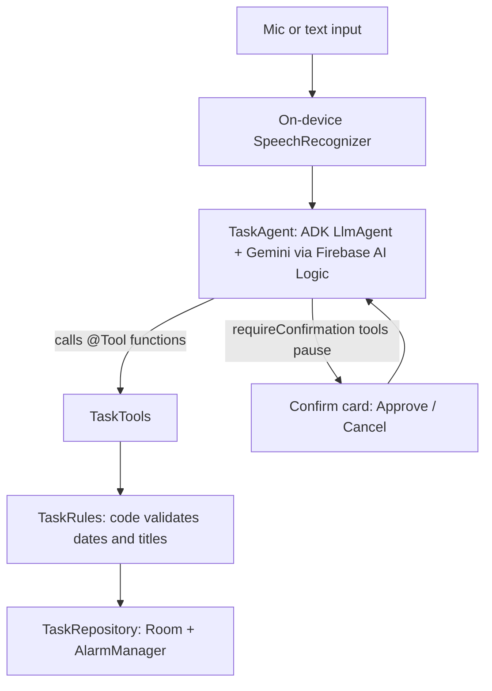

# TodoAgent 🤖📱

**The to-do app every Android developer has built, upgraded with an in-app AI agent.**

Say *"Review the pull request tomorrow morning, renew my passport before Friday, and book tickets for the Android Dev Summit on the 28th"* and get three correctly dated tasks with real reminders. Ask *"What's on my plate this week?"* and get an answer from your actual data. Risky actions like rescheduling or deleting always ask for your approval first.

Built with [ADK for Kotlin](https://github.com/google/adk-kotlin) (Google's Agent Development Kit), Gemini via Firebase AI Logic, and Jetpack Compose.

<!-- Add your demo video or GIF here -->

## Features

- **Voice or text:** on-device speech recognition feeds the agent; replies are read aloud.
- **Real tools, not chat:** the agent calls typed Kotlin functions (`addTask`, `getTasks`, `completeTask`, `rescheduleTasks`, `deleteTask`, `deleteCompletedTasks`).
- **Human in the loop:** destructive tools use ADK's `requireConfirmation`, so the agent pauses and the app shows a confirm card built from real data.
- **Code owns the facts:** the model never does date math. Every message carries a code-generated 14-day calendar, and every date or title the agent proposes is validated before it reaches the database.
- **Real reminders:** tasks schedule Android notifications with `AlarmManager`.
- **Survives restarts:** tasks live in Room; the agent's conversation state uses ADK's `RoomSessionService`.
- **No API key in the app:** Gemini is called through Firebase AI Logic, protected by App Check.

## How it works



The classic path (the **+** button and checkboxes) never touches the AI. The ✨ button and the mic go through the agent. Both use the same repository, so the agent can't do anything the regular app couldn't.

## Tech stack

| Area | Library |
|---|---|
| Agent framework | ADK for Kotlin 1.1.0 (`google-adk-kotlin-core`, `-processor`, `-firebase-android`) |
| Model | Gemini via Firebase AI Logic |
| Security | Firebase App Check (debug provider in development, Play Integrity in release) |
| UI | Jetpack Compose, Material 3 |
| Storage | Room |
| Voice | Android `SpeechRecognizer` (on-device when available), `TextToSpeech` |
| Build | AGP 9 with built-in Kotlin, KSP |

## Project structure

```
app/src/main/java/com/example/todoagent/
├── agent/       TaskAgent.kt (all ADK code), TaskTools.kt (@Tool functions)
├── data/        TaskDatabase.kt, TaskRepository.kt, TaskRules.kt (validation)
├── reminders/   Reminders.kt (AlarmManager + notifications)
├── voice/       Voice.kt (speech recognition + text-to-speech)
├── ui/          MainScreen.kt, MainViewModel.kt, Format.kt
├── MainActivity.kt
└── TodoAgentApp.kt
```

## Running it yourself

The repo doesn't include Firebase config, so you'll connect your own (free) Firebase project.

1. **Create a Firebase project** at [console.firebase.google.com](https://console.firebase.google.com) and add an Android app with package name `com.example.todoagent`.
2. **Download `google-services.json`** and place it in `app/`.
3. **Enable AI Logic:** in the console, open AI Logic → Get started → Gemini Developer API.
4. **Set up App Check:**
   - App Check → Apps → register the app with **Play Integrity** (use the SHA-256 from `./gradlew signingReport`).
   - Run the app once, find the line containing `DebugAppCheckProvider` in Logcat, and copy the debug secret.
   - App Check → Apps → ⋮ → **Manage debug tokens** → add the secret.
5. **Run** on a device with Android 8.0+ (Android 12+ for on-device speech recognition).
6. On the phone, allow **notifications** and **Alarms & reminders** for exact reminder timing.

Never commit your `google-services.json` (it's already in `.gitignore`) or share your debug token.

## Try these

- `Buy milk` → **+** (classic, no AI)
- 🎤 *"Pick up dry cleaning tomorrow, call the dentist before Friday and Mom's birthday is on the 12th."*
- 🎤 *"What's on my plate this week?"*
- 🎤 *"Push everything from tomorrow to Wednesday."* → confirm card
- 🎤 *"Add a meeting on January 1st 2019."* → rejected by code, explained by the agent
- 🎤 *"Remind me in 2 minutes to stretch."* → real notification

## Things I learned building it

- **ADK's `@Tool` processor requires nullable default parameters.** `filter: String = "open"` silently stopped code generation; `filter: String? = null` fixed it. When something KSP-generated is unresolved, check the Build window, not the editor.
- **Use `Int`, not `Long`, for tool parameters.** The processor describes `Long` to the model as text.
- **One agent turn is several model calls** (tool call, tool result, final reply). On the free tier's per-minute limit, a fast demo runs out quickly.
- **Firebase AI Logic with App Check enforced** means no API key ships in the APK, but development builds need a debug token.
- **Speech recognizers are finicky.** Reusing one recognizer instance and ignoring harmless post-result errors fixed "recognizer busy" on the second command.
- **Let the model interpret, let code decide.** Giving the model a calendar instead of asking it to calculate dates made every date correct.

## Limitations

- Reminders aren't restored after a device reboot.
- The agent uses cloud Gemini. An on-device Gemini Nano version (ADK's ML Kit extension, currently beta) is a planned experiment.
- This is a demo project, not a production app.

## License

Add a license of your choice (for example, MIT or Apache 2.0) if you want others to reuse the code.
